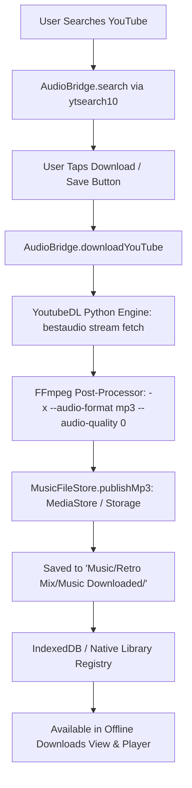

# Discovery & YouTube Offline Audio Pipeline

## 1. Overview
The **Discovery** section provides high-fidelity music browsing, regional trending charts, and dual-source audio acquisition:
1. **Open Audio (Internet Archive)**: Creative Commons & Public Domain MP3s.
2. **YouTube Audio (Android Native)**: On-device search, audio stream extraction, and offline MP3 transcoding.

---

## 2. YouTube Audio Extraction & MP3 Transcoding Architecture

### Key Components
- [`AudioBridgePlugin.kt`](file:///android/app/src/main/java/com/afterglow/player/AudioBridgePlugin.kt): Exposes `@PluginMethod fun downloadYouTube(call: PluginCall)`.
- [`YouTubeSource.kt`](file:///android/app/src/main/java/com/afterglow/player/YouTubeSource.kt): Executes `YoutubeDLRequest` with `--audio-format mp3` using `io.github.junkfood02.youtubedl-android:ffmpeg`.
- [`MusicFileStore.kt`](file:///android/app/src/main/java/com/afterglow/player/MusicFileStore.kt): Publishes into Android's public `MediaStore.Audio.Media` folder under `Music/Retro Mix/Music Downloaded/`.
- [`storageService.ts`](file:///src/services/storageService.ts): Persists track metadata and binary blobs/URIs into IndexedDB (`afterglow-audio`).
- [`DownloadsView.vue`](file:///src/components/downloads/DownloadsView.vue): Displays offline-cached MP3 tracks with file size, duration, and play/delete controls.

---

## 3. Platform Capabilities & Fallbacks

| Feature | Android (APK) | Web Browser (Desktop / Mobile Web) |
| :--- | :--- | :--- |
| **Regional Charts** | Apple iTunes RSS (25 songs) | Apple iTunes RSS (25 songs) |
| **Open Audio (Archive)** | Stream & Download directly to MP3 | Stream & Download via Blob/IndexedDB |
| **YouTube Search** | Native `ytsearch10` via YoutubeDL | Disabled (Requires native Android binaries) |
| **YouTube MP3 Conversion** | Native FFmpeg `audio/mpeg` transcode | Native only |
| **Offline Cache** | `MediaStore` + IndexedDB | IndexedDB ObjectStore (`tracks`) |
